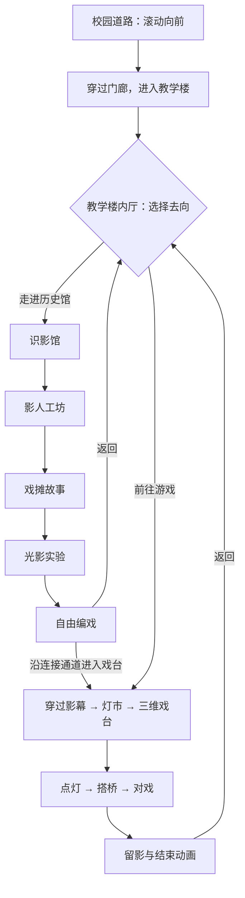

# 《借光·珞珈夜戏》连续动画与双路线改版任务书 V1.0

日期：2026 年 11 月 7 日  
基线：当前项目代码  
项目目录：`/Users/luochuhao/Desktop/借光-珞珈夜戏`

这版改版的核心是：**保留动画开场，进入教学楼后选择“历史馆”或“游戏”；历史馆的五部分全部融入连续滚动的场景，形成完整的动画旅程。**

基于当前代码改造，复用校园开场、影人资产、灯市、三维戏台及三关玩法。重点重构教学楼室内空间、路线分流、历史馆展陈和各环节的动画衔接。

最终体验必须让用户感到自己一直在同一个世界中行进：走进教学楼、选择去向、参观展馆或进入戏台，整个过程保持空间、镜头和操作的连贯性。

改版后的完整路线如下：

**教学楼内厅是本次改版新增的关键场景。** 原有校园道路与入楼动画继续沿用，镜头穿过门洞后，应抵达一个具有墙面、地面、灯光和纵深的内厅。

内厅设置两个可识别的空间入口：

- **左侧“历史馆”**：门内可见展品、影人或展廊灯光，说明文字为“循着光，认识一出戏的来处”。
- **右侧“皮影戏台”**：门内可见影幕与灯市光影，说明文字为“接过手杆，亲手开演”。

入口应依附在门洞、指示牌或场景物件上。鼠标悬停时，可通过灯光变化、门内景深和轻微镜头偏移给予反馈；点击后，镜头转向对应入口并穿门进入。移动端点击、键盘选择也必须可用。

用户未选择时，镜头停留在内厅，环境保持轻微动态。公共滚动路线在这里自然到达终点，不能继续滚动便自动进入某条分支。选择完成后再接入对应路线，衔接时保持当前视角和画面位置。

**历史馆是一条可以连续前进、反向返回的动画参观路线。** 五部分保留现有内容主题，但必须重新组织场景和交互，不能继续作为五张弹窗展板，也不能只用文字淡入淡出代替动画。

| 部分 | 场景、动画与互动要求 | 如何衔接下一部分 |
|---|---|---|
| **① 识影馆** | 镜头沿展廊前进，经过地域图、历史线索、影人藏品与传承人展示。滚动时展品有远近变化，光线逐步照亮细节，文字在相关物件旁出现。 | 镜头靠近一件影人，持续放大其材质和纹样，自然进入工坊观察尺度。 |
| **② 影人工坊** | 同一位影人在连续过程中经历制皮、镂刻、敷彩、装缀的数字示意：显出材料、形成纹样、铺入颜色、连接关节。用户可停下观察细节、换色和操纵手杆。 | 制作完成的影人被提起，走向亮起的幕布，成为下一段故事中的角色。 |
| **③ 戏摊故事** | 将《借光过桥》三幕做成滚动驱动的小剧场：归人出现、桥面展开、候人入场、两人相逢。滚动推进人物与景片动作，剧情文字跟随对应情节出现。 | 镜头沿幕布侧边绕到幕后，逐渐看见光源、影人和幕之间的关系。 |
| **④ 光影实验** | 直接在幕后的场景里移动灯和影人，实时观察幕前投影。滚动承担观察位置与演示过程的推进；拖动物件承担主动实验。灯、影人、影子始终对应，能直观看出距离和位置的影响。 | 镜头跟随光线回到幕前，幕布视野展开，进入可自由排演的舞台。 |
| **⑤ 自由编戏** | 用户在场景中的戏台上选景、摆放一至两位影人、调整姿势和朝向、填写标题。沿用草稿保存、最近六张作品及下载能力，操作控件与舞台结合。 | 保存时将当前演出画面收成戏票；继续前进可到达连接游戏的通道，也可选择返回内厅。 |

历史资料、工艺解释与原创剧情应保持清楚区分。工坊动画属于认知示意，不应表现为完整的真实制作教学。

每段都要包含明确的**进入、展开、互动、离开**过程。相邻段落之间至少有一个持续存在的视觉对象，例如同一个影人、同一束光、同一张幕或同一座桥，用它承接镜头与内容。

文字用于辅助理解，阅读时应保持稳定、清晰。较长资料可以按需展开，但完成主要参观流程不应依赖打开说明弹窗。

**游戏路线继续使用原有三关。** 用户从内厅选择游戏后，应沿原有“影幕—灯市—戏台”的动画路线前进，不必先参观历史馆。

抵达戏台时，镜头平滑停靠到可操作视角，游戏界面随之出现，再将控制权交给用户。点灯、搭桥、对戏的规则、判定、撤销与已有存档继续保留。

游戏操作期间暂停滚动运镜，戏台渲染和环境动画继续运行。退出游戏、完成关卡和进入留影环节时，都需要明确的镜头承接，避免画布突然换位、视角重置或页面瞬间跳到其他位置。

历史馆中的“自由编戏”属于开放创作；游戏路线承担三关挑战。两者分别保存原有状态，并共同接入留影册。

**“全程丝滑”需要落实为以下统一要求：**

1. **滚动连续控制场景。**  
   滚动距离应连续映射到镜头位置、观察方向及关键物件状态。缓慢滚动时能够看到中间过程，不能滚过阈值就突然换成下一屏。

2. **反向滚动同样成立。**  
   展馆里的镜头和演示过程可以沿原路返回。用户主动调整过的实验状态、编戏草稿和已保存作品，不因回滚被清除。

3. **转场具有空间依据。**  
   优先使用穿门、绕幕、靠近展品、跟随人物及前景遮挡完成衔接。黑屏、整屏淡出、白光闪烁不能成为主要转场方式。

4. **镜头速度平稳，操作响应及时。**  
   镜头启动和停止有短暂缓动，停止滚动后应迅速稳定。不得出现长时间追赶滚动位置、反向操作仍向前漂移或突然加速。

5. **阅读与观察可以停下来。**  
   用户停止滚动后，叙事进度停止，只保留灯笼、微光、呼吸感等轻微环境动态，不自动跳过内容。

6. **拖动与滚动职责清楚。**  
   拖灯、拖影人、操纵手杆时，由当前物件接收输入；松开后恢复浏览。移动端应有清晰的操作区域，避免整屏拦截滑动，也避免拖动物件时页面跟着移动。

7. **入口切换不打断画面。**  
   分支选择、进入游戏和返回内厅统一管理转场；快速重复点击不会启动多段互相冲突的镜头动画。

8. **素材提前准备。**  
   接近下一段时预加载并准备相关纹理与场景。素材尚未就绪时，保持当前完整场景，不让用户进入空白、缺贴图或尚未搭好的空间。

9. **性能不足时保持操作稳定。**  
   通过减少粒子、反射、阴影与渲染分辨率适配设备。减少动态效果模式保留完整内容和可操作性，降低大幅运镜与环境摆动。

**落实到当前代码，开发工作按下面的顺序完成：**

1. **重构路线控制。**  
   将 [continuous-journey.js](/Users/luochuhao/Desktop/借光-珞珈夜戏/src/continuous-journey.js:18) 从单一路线改为“公共开场、内厅、历史馆、游戏路线”的状态管理。分别记录路线进度、当前交互和转场状态，统一处理滚动、分支选择及返回。

2. **制作内厅与双入口。**  
   在 [passage-scene.js](/Users/luochuhao/Desktop/借光-珞珈夜戏/src/passage-scene.js:23) 的建筑与室内基础上扩展空间。现有室内背景不足以承担左右转向时，需要补充门洞、墙面、前景与纵深层，或建立必要的三维结构。

3. **完成一段连续体验样例。**  
   先打通“进入内厅 → 选择历史馆 → 识影馆 → 影人工坊”。这段必须展示真实的空间行进、同一展品的连续变化和反向回退，用于确认整套动画语言。

4. **完成其余展馆场景。**  
   按同样标准接入故事、光影实验和自由编戏。复用 [explore-data.js](/Users/luochuhao/Desktop/借光-珞珈夜戏/src/explore-data.js:7) 的内容及现有绘图、存储能力，替换目前以弹窗为中心的展示方式。光影实验必须与场景中的灯、影人和幕联动。

5. **衔接游戏与留影。**  
   保留三关核心逻辑，重做进入、退出、通关和留影的镜头交接；补齐历史馆与游戏之间的连接通道和返回内厅路径。

6. **完成适配、性能优化与回归验证。**  
   检查桌面、触屏、键盘、窗口缩放及减少动态效果模式，同时验证旧存档、原三关和新增创作流程。

**最终交付必须满足以下验收条件：**

| 验收项 | 完成标准 |
|---|---|
| 内厅分流 | 进入教学楼后清楚看到两个入口；历史馆和游戏均可独立进入、返回。 |
| 历史馆完整性 | 五部分全部进入连续场景，正常参观无需逐个打开弹窗。 |
| 动画连续性 | 慢滚、快滚、停止、反向滚动均无突跳、空白、明显接缝或错误视角。 |
| 互动完整性 | 工坊观察、光影实验、自由编戏、保存下载和原三关均可操作。 |
| 状态一致性 | 来回切换路线不会清空草稿、覆盖原存档或重复触发转场。 |
| 性能 | 桌面标准档以 60 FPS 为目标，约定测试设备上平均不低于 55 FPS、P95 帧间隔不超过 25 ms；移动端优先达到 60 FPS，降级档至少稳定在 30 FPS。报告记录设备、浏览器、分辨率、画质与实测结果。 |
| 观看舒适度 | 字幕有足够阅读区间，停滚后镜头迅速稳定；无持续抖动或无必要的大幅旋转。 |
| 验收材料 | 提供两条路线的完整录屏，覆盖分流、五段衔接、真实交互、反向返回和游戏进出；同时提供性能记录与功能检查结果。 |

交付物包括修改后的源码、新增素材及来源说明、路线与镜头配置说明、功能验证记录和完整体验录屏。**只有静态截图，或只展示单个场景的动画，不能视为本次改版完成。**
